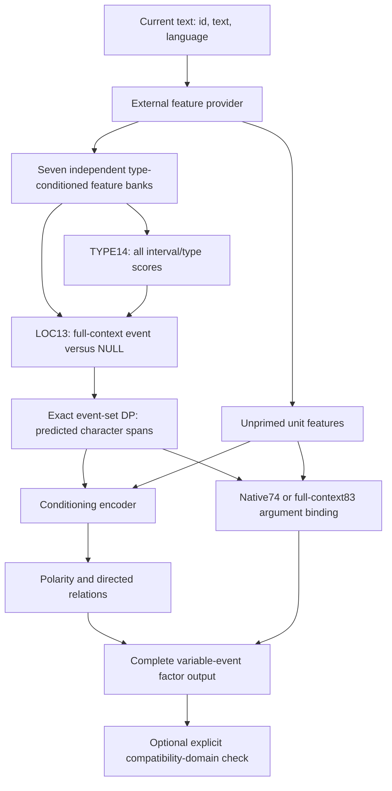

# M1 — Modular Event Understanding

> **Research archived — 24 October 2026. M1 remains NOT_FROZEN.**
> Further M1 training was ended by the project owner. The [research snapshot](RESEARCH_SNAPSHOT_20261024.md) preserves successes, failures, sources and project-owned weights; it does not claim final qualification. Existing Experimental 1 and the documented API below remain unchanged.
> [Research release](https://github.com/XRedMzK/M1-Event-Understanding/releases/tag/research-snapshot-20261024) · [Architecture history](ARCHITECTURE_HISTORY.md) · [Checkpoints](CHECKPOINT_CATALOG.md) · [Known limitations](KNOWN_LIMITATIONS.md) · [Reproduction](REPRODUCIBILITY.md) · [Rights/data](RESEARCH_RIGHTS_AND_DATA.md)

[](LICENSE)


M1 is an experimental Python toolkit that turns text and compatible neural
features into structured events: where each event occurs, its type, who or what
participates, whether it is negated, and how events are ordered. Separate learned
components make these decisions inspectable and replaceable. An optional learned
canonicalizer maps participant mentions to symbols within a limited inventory.

**M1 is still experimental and supports a narrow set of event types.** Its current
trained states do not meet all project quality criteria. It is not a completed
M1 v1.5 release or a production-ready language-understanding system. See
[Experimental Checkpoints](#experimental-checkpoints) for the first trained
checkpoint and its measured limitations.

Trained weights and donor-model assets are separate from this source repository.
The two existing feature examples use invented features and untrained states to
demonstrate interfaces; their outputs are not evidence of semantic accuracy.

## Input and output

```text
English or Russian text
  + the checkpoint's compatible feature provider
  + trained M1 state
        ↓
event spans and types
  + participant spans and roles
  + polarity and directed event relations
  + optional canonical participant symbols
```

For example, the intended structure for `Ivan opened a door.` can be represented
as follows. **This JSON is a handwritten illustration of the output interface,
not a model prediction or a measured result.** Character ranges are half-open
Python string offsets.

```json
{
  "sentence_id": "illustration-1",
  "events": [{
    "event_index": 0,
    "char_start": 5,
    "char_end": 11,
    "TYPE": "OPEN",
    "polarity_id": 1,
    "roles": [
      {"role_index": 0, "char_start": 0, "char_end": 4, "surface": "Ivan"},
      {"role_index": 7, "char_start": 14, "char_end": 18, "surface": "door"}
    ]
  }],
  "relations": []
}
```

Here role `0` is agent, role `7` is object and polarity `1` is affirmative. Real
predictions may omit events, choose extra events or assign the wrong arguments;
the [Experimental 1 record](docs/EXPERIMENTAL_1.md) reports the observed errors.
The [API reference](docs/API.md) defines the complete output and numeric IDs.

## Experimental Checkpoints

**M1 Experimental 1** is a published research checkpoint, marked **Pre-release**.
It is not a new architecture version and does not claim completed M1
qualification. The checkpoint contains genuinely trained component states, with
compatibility, integrity and numerical parity checked separately from semantic
quality.

Download the weights and checksums from
[`experimental-1`](https://github.com/XRedMzK/M1-Event-Understanding/releases/tag/experimental-1).
Binaries are release attachments and are excluded from ordinary Git history.
The release targets source commit `426d13fb767fca286e960c123d84c53130e19de6`.

See the [checkpoint composition, download commands, exact results and known errors](docs/EXPERIMENTAL_1.md)
and the [Feature Provider audit](docs/FEATURE_PROVIDER.md) before attempting real
inference. Compatible feature origins matter: an arbitrary encoder with the same
output width cannot replace the provider used to train these weights.

## Purpose

Make a bounded event-understanding pipeline inspectable, testable and replaceable.
The project follows: **Use science to design the architecture; use engineering
evidence to determine whether it works.** Implementation tests and model-quality
evidence are separate requirements.

The public integration boundary is a complete event/factor structure. Memory,
dialogue policy, application consumers and hosted inference services are outside
this repository.

## Features

- Complete interval scoring across seven event types: `PURCHASE`, `GIVE`, `OWN`,
  `OPEN`, `CLOSE`, `REPORT`, `SHOW`.
- Event-versus-NULL localization with full-context span conditioning, 31 relative
  position buckets and exact non-overlapping event-set dynamic programming.
- Native 74-tensor and full-context 83-tensor argument owners, joint role
  interaction, NULL arguments and native beam-8 decoding. Beam search is not an
  exhaustive global optimum guarantee.
- Polarity and directed `NONE`/`BEFORE`/`AFTER` relation outputs conditioned on
  predicted events. Component output retains variable event counts, including
  empty and three-or-more-event cases.
- Explicit CPU FP32 state/feature geometry, independent parameter storage,
  mutation checks, deterministic state restoration and saved-score replay.
- Data-only safetensors state bundles with independently supplied SHA-256
  commitments. No pickle or executable checkpoint loader.
- Separate canonicalization/slot utilities and an explicit compatibility-domain
  guard. No application-specific dense-vector or consumer compatibility claim.

## Architecture



Features are ordinary, contiguous CPU FP32 tensors of shape `[units, 2048]`.
Each sentence requires one unprimed bank and **all seven** separate conditioned
banks, with identical original character-unit geometry. They are captured before
event prediction; Gold spans, labels and annotation-driven feature selection are
not inference inputs. A `FeatureProvider` supplies this interface. The package
does not verify a provider's training history or feature origin and does not
silently substitute an encoder.

The runtime restores five neural owners from supplied states. Optional
canonicalization and slot utilities are separate owners. Parameter-tensor counts
describe topology, not model quality or parameter counts.

## Requirements

- Python **3.12** is the tested interpreter.
- PyTorch **2.13.0**, NumPy **2.5.2**, safetensors **0.8.0**.
- CPU is sufficient for the supplied tests and examples; CUDA is not required.
- Hardware for a real feature provider depends on the chosen external encoder.
  This release makes no full-model VRAM, RAM, latency or throughput guarantee.
- Interval work grows quadratically with the number of character units. Callers
  must set input/resource budgets appropriate to their application.

See [dependency licenses](docs/DEPENDENCIES.md),
[validation scope](docs/VALIDATION.md) and the
[Feature Provider requirements](docs/FEATURE_PROVIDER.md).

## Installation

Create a new environment in a checkout of this repository:

```bash
python3.12 -m venv .venv
source .venv/bin/activate
python -m pip install --upgrade pip
python -m pip install torch==2.13.0 --index-url https://download.pytorch.org/whl/cpu
python -m pip install -e '.[test]'
```

For another platform or a CUDA build, use the
[official PyTorch installer](https://pytorch.org/get-started/locally/) first.
The package pins its tested core versions; GPU/provider dependencies are not
installed implicitly.

## Run the examples

```bash
python examples/feature_localization.py
python examples/feature_pipeline.py
```

Both examples run locally without credentials, downloads or external assets.
They explicitly report invented/untrained state and no accuracy claim. The first
exercises TYPE and LOC; the second exercises the complete component pipeline.

For your own compatible features and trained states:

```python
import torch
from m1 import RawText, predict_raw
from m1.checkpoint import load_state_bundle
from m1.factories import components_from_states

torch.set_num_threads(2)
# Obtain both hashes through a trusted channel independent of the bundle.
bundle = load_state_bundle(
    "model-state",
    expected_archive_sha256=trusted_hashes["archive_sha256"],
    expected_manifest_sha256=trusted_hashes["manifest_sha256"],
)
models = components_from_states(bundle.states, binding_kind="full_context83")
rows = (RawText("turn-1", "Participant_A opened the container.", "en"),)
result = predict_raw(rows, models=models, provider=my_feature_provider)
print(result.factors)
```

This integration sketch requires a caller-supplied provider and trained state;
the runnable examples above supply invented fixtures instead. See
[the interfaces](docs/API.md) for shapes, state groups, guards and output IDs.

## Testing

```bash
python -m pytest
python -m compileall -q src tests examples
```

Tests use invented text/tensors and real numerical components. They cover exact
DP against exhaustive enumeration, gradients, full-context dependence, TYPE
intervals, variable event counts, joint binding/replay, state isolation and
checkpoint authentication. They do not need private datasets, a GPU or trained
weights. GitHub Actions is configured for CPU tests; an actual hosted CI result
is only established after the workflow runs.

## Development status and limits

| Factor | Public implementation | Remaining quality work |
| --- | --- | --- |
| LOC | Full-context relative event/NULL scoring and exact set DP | Generalization and integrated qualification |
| TYPE | Supplied native14, seven-type dense interval scores | Exact conditional identity qualification |
| BIND | Native74/full-context83, joint role context and beam-8 replay | Full-span and cross-event transfer qualification |
| POL | Supplied conditioned polarity heads and existing decision rule | Qualification on predicted event spans |
| REL | Directed relation inference in the composed path | Full integrated qualification |
| CAN | Optional learned mention canonicalization | Limited inventory, context transfer and integrated qualification |

English and Russian are accepted input-language identifiers; this is not a claim
of proven bilingual coverage. The ontology is fixed and narrow. No calibrated
confidence, open-domain coverage, unseen-construction guarantee, production SLA
or completed M1 freeze is claimed.

The original optional compatibility domain is at most two events, 96 UTF-8 bytes per
mention and 4096 UTF-8 bytes per text. Domain failures are explicit; complete
component results are retained rather than clipped. Existing application-specific
consumer/vector formats and historical checkpoint envelopes are not included.
Public state bundles and external features must be mutually compatible; renaming
or supplying tensor shapes alone does not establish model compatibility.
The Experimental 1 CAN component has a separately declared 128-byte mention
boundary; it must not be restored as the original 96-byte owner. See
[checkpoint compatibility](docs/EXPERIMENTAL_1.md).

## Roadmap

1. Expand public end-to-end regression coverage and independent numerical parity.
2. Publish a redistributable training recipe and appropriately licensed data.
3. Improve localization and full-span/cross-event binding generalization.
4. Qualify all factors together on fresh, independently defined evaluations.
5. Release experimental trained checkpoints with explicit rights, compatibility,
   resource measurements and quality limitations.

## Research challenges

Interested in independently reviewing event localization, argument-role binding,
or multi-event composition? See [Research Challenges](docs/RESEARCH_CHALLENGES.md)
for current questions, code entry points, and links to open research issues.
Implementation tests do not establish model accuracy. The checkpoint candidate's
development results are reported separately and are not an independent public
benchmark or a completed final qualification.

## Contributing and license

Start with [CONTRIBUTING.md](CONTRIBUTING.md), run the tests, then open a focused
issue or pull request. Use [SECURITY.md](SECURITY.md) for vulnerability reports.

Project-owned source is licensed under [MIT](LICENSE). Dependencies and any
externally supplied models/data retain their own licenses; see
[THIRD_PARTY_NOTICES.md](THIRD_PARTY_NOTICES.md). MIT does not automatically cover
external assets.

